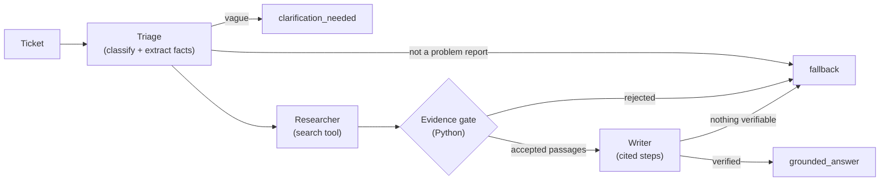

# Multi-Agent RAG for Technical Support

[](https://github.com/BkHassan/agentic-rag-for-technical-support/actions/workflows/ci.yml)

An assistant that analyzes IT support tickets and proposes troubleshooting steps **only when the internal documentation supports them**. When a ticket is too vague, it asks the reporter for the missing details. When the documentation cannot back an answer, it says so and routes the ticket to a person instead of guessing.

**Intended use:** a demonstration and evaluation project, run on a fixed ticket set against a 14-document knowledge base. The results show the designed behaviors work on that set; they do **not** establish production reliability.

## Contents

[The problem](#the-problem) · [The solution](#the-solution) · [Architecture](#architecture) · [Design decisions](#design-decisions-and-trade-offs) · [Implementation](#implementation) · [Results](#results) · [Intended use and limitations](#intended-use-and-limitations) · [Getting started](#getting-started) · [Tests and evaluation](#tests-and-evaluation) · [Roadmap](#roadmap) · [Project layout](#project-layout)

## The problem

First-line IT support spends much of its time on tickets whose answer already exists in an internal runbook: a database that times out, a hostname that stopped resolving, an HTTP 504 on checkout. Finding the right runbook and the right section is slow, and different engineers give different answers to the same ticket.

A general-purpose chatbot looks like the obvious fix, but it fails in a way that matters in support:

- **It answers fluently even when it does not know.** A confident, invented step ("raise `max_connections` to 500", "restart the database") can cause an outage. In support, a wrong answer costs more than no answer.
- **It cannot show where an answer came from,** so an engineer has to re-check everything it says.
- **It answers vague tickets anyway.** "It stopped working after yesterday" gets a generic checklist instead of the one question that would make the ticket actionable.

So the requirement is not "answer every ticket". It is:

1. Answer only what the documentation backs, and show the exact passage for every step.
2. Ask for details when the ticket does not say what fails.
3. Say clearly when there is no documented answer, and hand the ticket to a person.

## The solution

Every ticket ends in exactly one of three outcomes, and each one is useful to the support team:

| Outcome | When | What the team gets |
|---|---|---|
| `grounded_answer` | Relevant documentation exists and every step can be verified against it | Troubleshooting steps, each linked to the passage it was copied from |
| `clarification_needed` | The ticket names no observable symptom | Two or three questions for the reporter, and no search is run |
| `fallback` | No documented answer can be verified | A fixed message routing the ticket to manual review, plus the passages that were checked |

Four principles shape the design:

- **Evidence before answers.** The Writer only runs when a deterministic evidence gate accepts the retrieved passages. The gate is a heuristic retrieval filter, not a correctness check.
- **Code decides, models propose.** Gemini agents produce typed outputs; a Python Coordinator owns every decision about what runs next and what the user sees.
- **Every answer is traceable.** Each recommended step must appear word for word in the passage it cites, and the console shows that passage under the step.
- **Measure, do not claim.** A held-out ticket set, a separate calibration set, and an evaluation harness that never counts an API error as a pass.

## Architecture



| Part | Role |
|---|---|
| **Coordinator** (Python) | Runs each stage at most once, validates every hand-off, applies time limits, builds the response |
| **Triage** (Gemini) | Category plus completeness facts: is it a troubleshooting request, which system, which symptom |
| **Clarification policy** (Python) | Asks the reporter for detail when no observable symptom was stated; no search is run |
| **Researcher** (Gemini) | Decides whether to search and writes the query; the host executes `search_technical_documentation` once |
| **Evidence gate** (Python) | Accepts passages only if the best match is close enough and stands out from unrelated documents |
| **Writer** (Gemini) | Writes steps from accepted passages only; unsupported steps are dropped |

The agents never call each other or act on their own. A sequence diagram, the gate's rules, and error handling are in [docs/ARCHITECTURE.md](docs/ARCHITECTURE.md).

## Design decisions and trade-offs

| Decision | Why | Cost |
|---|---|---|
| **A Python Coordinator owns control flow**, not autonomous agents | Predictable, testable runs with bounded cost: at most one model call per agent, plus retries | No multi-step research: the Researcher gets one search per ticket |
| **A deterministic evidence gate** decides whether the Writer runs, instead of asking the model | Reproducible decisions with thresholds fitted on 53 labeled calibration tickets | The thresholds were calibrated on ticket text but now score the Researcher's query (see [Limitations](#intended-use-and-limitations)) |
| **Word-for-word verification** of each step and its quote | No invented commands, values, or filenames reach the user | Correct but paraphrased steps are dropped, so some answerable tickets fall back |
| **Fixed, application-owned clarification and fallback text** | Prompt injection in a ticket cannot change what these outcomes say | Less tailored wording |
| **Local ChromaDB in a single process** | No database server to run; one command starts everything | Not horizontally scalable; SQLite is not safe across workers |
| **`gemini-3.5-flash-lite` as the configured model** | Fits the free-tier quota | Lower quality ceiling than larger models |

## Implementation

| Layer | Technology |
|---|---|
| Agents | Gemini through `google-genai`, structured (schema-checked) outputs |
| Retrieval | ChromaDB with `gemini-embedding-001` embeddings over Markdown runbooks |
| API | FastAPI: `POST /tickets/analyze`, `GET /health` |
| Console | React, TypeScript, Vite; CSS modules with light and dark themes |
| Packaging | Docker Compose (API plus nginx-served console) |
| Quality | pytest, Vitest, oxlint, GitHub Actions |

Key mechanisms:

- **Typed hand-offs.** Every stage result is a Pydantic model that rejects unknown fields, and the run state is checked for consistency at each step.
- **Grounding checks in code.** Each step the Writer returns must appear word for word (ignoring whitespace) in the passage it cites, and so must its supporting quote; numbers, filenames, commands, and destructive actions are checked too. The host drops any step that fails. The short summary is checked more loosely: it may not introduce filenames, numbers, commands, or destructive actions absent from the passages.
- **Bounded time.** Triage, research, and the Writer each have a time limit (45 + 65 + 45 s); Gemini retries are skipped when they would pass the stage deadline. The console waits 160 s.
- **Safe failures.** Every failure path ends in a fallback or a fixed error message; exception text, upstream messages, and keys never reach the client, and log records are redacted.
- **Observability without a monitoring service.** Each response carries an `X-Request-ID`, and the API logs one line per stage with counts, codes, and durations, never ticket or passage text:

  ```text
  INFO app.events event=stage request_id=<id> stage=evidence_gate duration_ms=<ms> status=ok next=writing gate_decision=accepted reason_code=accepted accepted_count=<n> …
  ```

- **An explainable console.** It shows each step's source passage, the full passages with an expand toggle, the three outcomes with their own views, and specific error messages with the request ID.

Response fields per outcome:

| `outcome` | Meaning |
|---|---|
| `grounded_answer` | Recommendations with cited `sources`; `sufficient_evidence: true` |
| `clarification_needed` | `clarifying_questions`, no recommendations, no search |
| `fallback` | The fixed message *"Insufficient supporting documentation was found to provide reliable troubleshooting recommendations. Please review the ticket manually."* |

Example request and the clarification response (the questions and summary are fixed strings; `category` comes from the model):

```http
POST /tickets/analyze
Content-Type: application/json

{"ticket_id": "T-VAGUE-001", "description": "It stopped working after yesterday."}
```

```json
{
  "ticket_id": "T-VAGUE-001",
  "category": "application",
  "outcome": "clarification_needed",
  "clarifying_questions": [
    "Which system or feature is affected (for example the website, sign-in, VPN, file uploads, or a specific database)?",
    "What exactly happens? Please include the exact error message or code, or describe what you see instead of the expected result.",
    "When did it start, and is it affecting one user, a team, or everyone?"
  ],
  "recommendations": [],
  "sources": [],
  "sufficient_evidence": false,
  "fallback_triggered": false,
  "summary": "More detail is needed before documented troubleshooting steps can be recommended. Please answer the questions below."
}
```

## Results

A single live run on the 20-ticket held-out set, from 2026-10-26, using `gemini-3.5-flash-lite` with `gemini-embedding-001`. Full report: [evaluation/results/RESULTS.md](evaluation/results/RESULTS.md).

| Measure | Result |
|---|---|
| Tickets passed / failed / infrastructure error | 18 / 1 / 1 |
| Final outcome (scored tickets) | 18/19 |
| Tool selection | 19/19 |
| Citation correctness (grounded answers) | 8/8 |
| Gemini calls (incl. retries) / embedding requests | 46 / 14 |
| Tokens, provider-reported (input / output) | 22,143 / 5,697 |
| Latency p50 | 3.2 s |
| Estimated cost | not estimated (no prices supplied) |

The failed ticket (E-REL-005) fell back although relevant documents were found. The infrastructure error (E-REL-006) was a per-minute rate limit that outlasted the stage timeout. Citation correctness checks *which* documents are cited, not whether each sentence is faithful; sentence-level support is enforced at runtime by the Writer check and is not scored separately. A single run of 20 tickets cannot show run-to-run variance. Earlier runs and their caveats are in [docs/ARCHITECTURE.md](docs/ARCHITECTURE.md#measured-results).

## Intended use and limitations

**Intended for:** demonstrating and evaluating evidence-grounded ticket analysis on a small, known documentation set, run locally by a trusted user.

**Not intended for:** handling real customer tickets, replacing support engineers, or unattended use.

- **Small corpus.** 14 Markdown documents, and a 20-ticket evaluation from single runs. Treat the results as evidence the mechanism works, not as a reliability figure.
- **Clarification hinges on one Triage call.** The known regression E-REL-004 ("cannot resolve internal hostnames…") has been wrongly sent to clarification in some runs.
- **Gate calibration mismatch.** The gate's thresholds were calibrated on ticket-text scores but now score the Researcher's query. Passing the gate means the passages are close to the query, not that the answer is correct.
- **Answers vary between runs.** The Writer's output varies, so the same ticket can be grounded on one run and fall back on the next when no step survives the word-for-word check.
- **Local, trusted use only.** The API has no authentication, rate limiting, or request-size limit on ticket fields, and clarification is single-turn. Add these before handling real tickets.
- **Prompt injection.** A few unit tests check that injected instructions in tickets and passages cannot change an agent's role, tool call, or citations. There is no adversarial evaluation, so this is not a robustness claim.
- **Quota.** Free-tier Gemini quotas are small. Evaluation runs have hit per-minute 429s and the daily cap, and `.env.example` warns that the code-default model allows very few free requests per day.
- **Security.**
  - Keys are never logged; log records are redacted.
  - Keys are not built into images, and `.env` is git-ignored.
  - Client errors carry fixed messages only.
  - Ticket text and passages are treated as data, and citations and tool calls are checked in Python.

More detail is in [docs/ARCHITECTURE.md](docs/ARCHITECTURE.md#limitations).

## Getting started

Requires Python 3.12 (the version the Docker image and local runs use) and a Gemini API key from [Google AI Studio](https://aistudio.google.com/apikey).

```bash
python -m venv .venv
.venv\Scripts\activate          # Windows
# source .venv/bin/activate     # macOS/Linux
pip install -r requirements-dev.txt -c constraints.txt
copy .env.example .env          # or: cp .env.example .env
```

`requirements.txt` holds the runtime dependencies (the Docker image installs only these), `requirements-dev.txt` adds the test tools, and `constraints.txt` locks every transitive version to the tested environment.

Set your key in `.env`. The example file already selects the demo model:

```env
GOOGLE_API_KEY=your_api_key_here
LLM_MODEL=gemini-3.5-flash-lite
```

Build the local index, then start the API:

```bash
python -m app.retrieval.ingestion     # embeds data/technical_docs/ into data/chroma/ (re-embeds all 14 docs each run)
uvicorn app.main:app --reload
```

- API docs: http://127.0.0.1:8000/docs
- Endpoints: `POST /tickets/analyze`, `GET /health`. Every response carries an `X-Request-ID` header.
- Browser console: see [frontend/README.md](frontend/README.md).
- One-off run from the command line: `python -m app.orchestration.coordinator`. This makes live Gemini calls.

### Docker

```bash
docker compose up --build
```

This serves the console at http://localhost:8080 and the API at http://127.0.0.1:8000/docs. The key is read from `.env` at runtime and is not built into the images. The first start embeds the docs into a Docker volume; later starts skip ingestion while that index exists. To rebuild the index:

```bash
docker compose run --rm --no-deps --entrypoint python api -m app.retrieval.ingestion
```

### Configuration

Settings live in `app/config.py` and can be overridden by environment variables or `.env`, using the upper-case field name.

| Variable | Default | Meaning |
|---|---|---|
| `GOOGLE_API_KEY` | none | Gemini API key (required) |
| `LLM_MODEL` | `gemini-3.8-flash` (`.env.example` sets `gemini-3.5-flash-lite`) | Model for all three agents |
| `EMBEDDING_MODEL` | `gemini-embedding-001` | Embeddings for ingestion and search |
| `RETRIEVAL_TOP_K` | `5` | Chunks returned per search |
| `RELEVANCE_MAX_DISTANCE` / `RELEVANCE_MIN_CONTRAST` / `RELEVANCE_CONTRAST_RANK` | `0.3687` / `0.0442` / `5` | Calibrated evidence-gate thresholds |
| `MODEL_CALL_TIMEOUT_SECONDS` / `TOOL_EXECUTION_TIMEOUT_SECONDS` | `45` / `20` | Per-call bounds |
| `LOG_LEVEL` | `INFO` | API log level; stage and request events (`event=stage …`) are INFO |

The two model values differ on purpose. Without `LLM_MODEL`, the code uses `gemini-3.8-flash`. `.env.example` overrides it with `gemini-3.5-flash-lite` because, as its comment notes, `gemini-3.8-flash` is limited to about 20 free requests per day. All results above were measured with `gemini-3.5-flash-lite`.

## Tests and evaluation

**CI** ([.github/workflows/ci.yml](.github/workflows/ci.yml)) runs the offline backend tests, the frontend lint, tests and production build, and builds both Docker images on every pull request and push to `main`. It uses no secrets and makes no Gemini calls.

**Offline tests** (deterministic; models and retrieval are faked, no API calls):

```bash
pytest tests -q
cd frontend && npm test
```

**Live tests** are marked `live` and run only when you opt in:

```bash
RUN_LIVE_TESTS=1 pytest tests -m live -q      # bash; also needs GOOGLE_API_KEY
# PowerShell: $env:RUN_LIVE_TESTS="1"; pytest tests -m live -q
```

**Live evaluation** (calls Gemini; about 46 generation and 14 embedding requests for the 20 tickets):

```bash
python -m evaluation.run_evaluation                                   # 20-ticket held-out set
python -m evaluation.run_evaluation --ticket-id E-REL-004             # one ticket
python -m evaluation.run_evaluation --baseline evaluation/results/perf_baseline.json   # compare on the same tickets
python -m evaluation.run_evaluation --dataset evaluation/regression_tickets.json      # regression set, reported separately
python -m evaluation.run_evaluation --rescore                         # offline: re-score saved traces
```

- **Ticket status.** Each ticket is `passed`, `failed`, `infrastructure_error`, or `not_executed`. Only `passed` counts.
- **Partial runs.** Results are saved after every ticket, and a run stopped by quota is marked incomplete and lists the tickets it did not run.
- **Cost.** It is estimated only when you pass `--input-usd-per-mtok` and `--output-usd-per-mtok`.

**Data separation.** The gate thresholds are fitted on `evaluation/calibration_tickets.json` (53 labeled tickets). Those tickets share no IDs or text with the 20-ticket evaluation set, and the runner refuses to evaluate the calibration file. Expected labels are never edited to match the system.

```bash
python -m evaluation.calibrate_relevance                    # live: embeds the calibration tickets and fits
python -m evaluation.calibrate_relevance --reuse-features   # offline: refit from saved scores
```

## Roadmap

Planned, not implemented:

- Return the fallback reason and the Researcher's search query in the API response, so the console can explain every outcome.
- Re-fit the gate thresholds on Researcher-query scores, or score the original ticket text again.
- Report multi-run variance instead of single runs, and run the regression set against the multi-agent pipeline.
- A readiness check (key configured, index present) separate from `/health`.
- Authentication, rate limiting, and conversation state for clarification follow-ups.

The full list is in [docs/ARCHITECTURE.md](docs/ARCHITECTURE.md#planned-not-implemented).

## Project layout

```text
app/
  main.py                 FastAPI app: POST /tickets/analyze, GET /health
  orchestration/          workflow.py (Coordinator), coordinator.py (traces, entry points), model.py (Gemini calls, retries)
  agents/                 triage.py, researcher.py, writer.py, state.py (shared run state)
  policies/               clarification.py, evidence.py (evidence gate)
  retrieval/              ingestion.py, retrieval.py (ChromaDB)
  tools/knowledge_base.py search tool definition
  observability.py        request IDs, stage events, log output, redaction
  usage.py                per-request call and token counters
  config.py, schemas.py
data/technical_docs/      the 14-document knowledge base
docs/ARCHITECTURE.md      design, limits, measured results
evaluation/               datasets, run_evaluation.py, scoring.py, calibrate_relevance.py, results/
frontend/                 browser console
tests/                    offline tests (+ opt-in live tests)
.github/workflows/ci.yml  continuous integration
requirements*.txt, constraints.txt   runtime and dev dependencies, locked versions
```

`app/agent.py`, `app/clarification.py`, and `app/rag/` are compatibility wrappers around the modules above.

## Publishing notes

Keep real keys only in your local `.env`. The repository ships `.env.example` with a placeholder.
